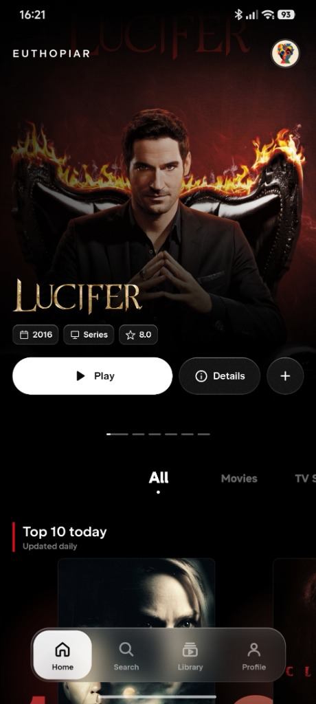
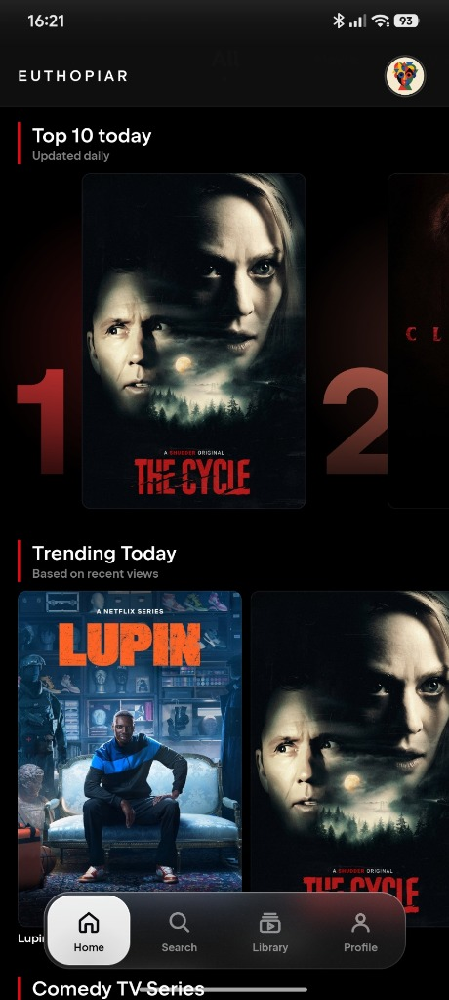
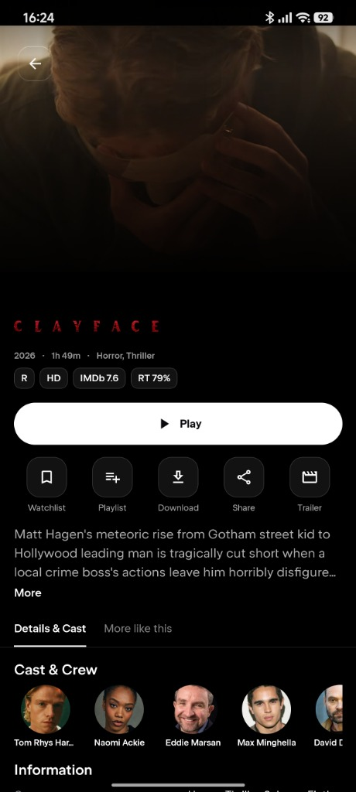
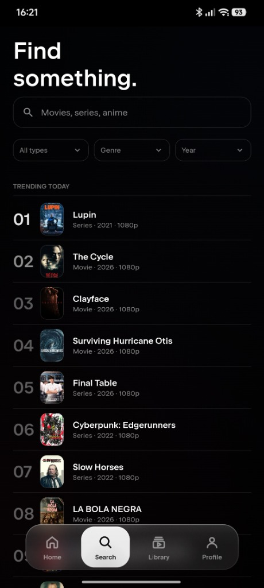
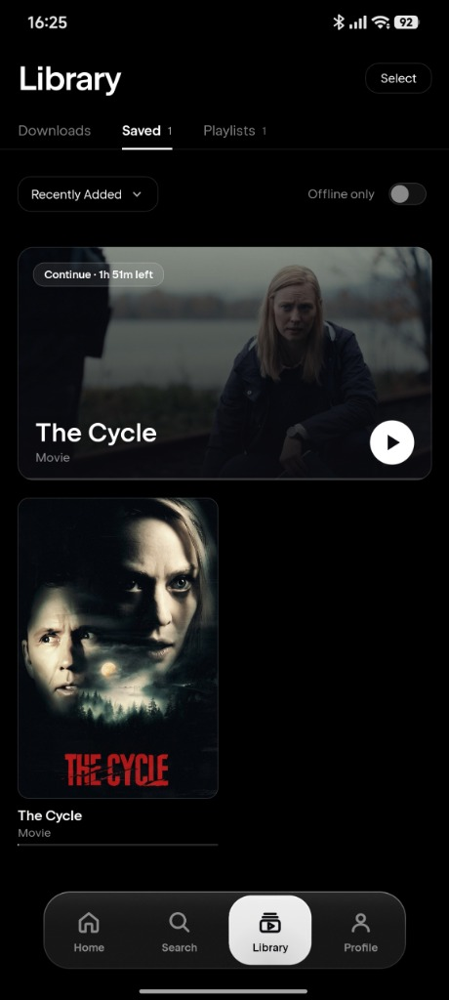

<div align="center">


# E U T H O P I A R

### 🎬 Your Movies, Series & Anime — All in One Beautiful App

[](https://github.com/TheARCreactorGUY/Euthopiar-/releases/latest)
[](https://github.com/TheARCreactorGUY/Euthopiar-/releases/latest)
[](https://kotlinlang.org/)
[](https://github.com/TheARCreactorGUY/Euthopiar-)

<br/>

[](https://github.com/TheARCreactorGUY/Euthopiar-/releases/latest)
[](https://github.com/TheARCreactorGUY/Euthopiar-/releases)

</div>

---

<div align="center">

# 🔌 NUVIO PLUGINS — BUILT-IN COMPATIBILITY

## ✅ Euthopiar works with Nuvio Plugins out of the box!

### 👇 Copy this plugin manifest link and add it in the app 👇

```
https://raw.githubusercontent.com/TheARCreactorGUY/Plugins/main/manifest.json
```

[](https://raw.githubusercontent.com/TheARCreactorGUY/Plugins/main/manifest.json)

</div>

---

## 📱 Platform Availability

| Platform | Status |
|---|---|
| 📱 **Android Smartphone App** | ✅ **Available now** — [Download](https://github.com/TheARCreactorGUY/Euthopiar-/releases/latest) |
| 📺 **Android TV App** | 🚧 **Coming soon** — stay tuned! |

## 📖 What is Euthopiar?

**Euthopiar** is a modern, Netflix-style Android app for discovering and watching **movies, TV series and anime**. It has a clean dark design, big cinematic posters, and a smooth, easy-to-use interface — so you can find something to watch in seconds.

## ✨ Features

| | Feature | Description |
|---|---|---|
| 🏠 | **Cinematic Home** | Big featured banner, *Top 10 Today*, *Trending Today* and genre rows |
| 🔍 | **Smart Search** | Search movies, series & anime with filters for type, genre and year |
| 🎞️ | **Rich Details Page** | Ratings (IMDb / Rotten Tomatoes), runtime, cast & crew, similar titles |
| 📥 | **Downloads** | Save titles to watch offline |
| 🔖 | **Watchlist & Playlists** | Save favourites and organise them your way |
| ▶️ | **Continue Watching** | Pick up exactly where you left off |
| 🔌 | **Nuvio Plugins Compatible** | Built-in support for Nuvio plugins |
| 🌑 | **Dark, Modern UI** | Smooth navigation with a floating bottom bar |

## 📸 Screenshots

<div align="center">

| Home | Trending | Details |
|:---:|:---:|:---:|
|  |  |  |

| Search | Library |
|:---:|:---:|
|  |  |

</div>

## 📲 Download & Install

1. Go to the **[Latest Release](https://github.com/TheARCreactorGUY/Euthopiar-/releases/latest)** page.
2. Download the **`.apk`** file.
3. Open it on your Android phone and allow *"Install from unknown sources"* if asked.
4. Open Euthopiar and enjoy! 🍿
5. *(Optional)* Add the Nuvio plugin manifest link above to unlock more sources.

<div align="center">

[](https://github.com/TheARCreactorGUY/Euthopiar-/releases/latest)

</div>

## 🛠️ Build From Source

```bash
git clone https://github.com/TheARCreactorGUY/Euthopiar-.git
cd Euthopiar-
./gradlew assembleDebug
```

The APK will be in `app/build/outputs/apk/debug/`.

## ⚠️ Disclaimer

Euthopiar does not host or store any media. Content is provided by third-party plugins/sources added by the user. Please respect copyright laws in your country.

## ☕ Support the Project

Euthopiar is free and open source. If you enjoy it, you can support its development by buying me a coffee — it helps keep the app alive and growing!

<div align="center">

[](https://buymeacoffee.com/TheARCreactorGUY)

<a href="https://buymeacoffee.com/TheARCreactorGUY"></a>

*Scan the QR code or click the button above.*

</div>

## ⭐ Star the Repo

Can't donate? Give the project a **star ⭐** on GitHub — it really helps too!

<div align="center">

Made with ❤️ by [TheARCreactorGUY](https://github.com/TheARCreactorGUY)

</div>
