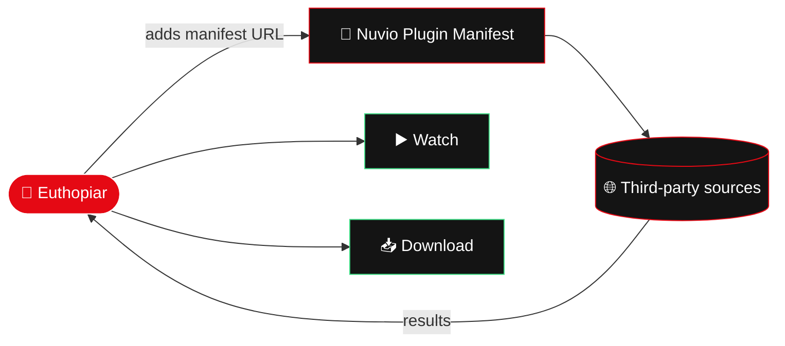

<div align="center">


<a href="https://github.com/TheARCreactorGUY/Euthopiar-/releases/latest">
  
</a>

<br/>

[](https://github.com/TheARCreactorGUY/Euthopiar-/releases/latest)
[](https://github.com/TheARCreactorGUY/Euthopiar-/releases/latest)
[](#-roadmap)
[](https://kotlinlang.org/)
[](https://github.com/TheARCreactorGUY/Euthopiar-)

<br/>


<br/>

[](https://github.com/TheARCreactorGUY/Euthopiar-/releases/latest)
[](https://github.com/TheARCreactorGUY/Euthopiar-/releases)
[](https://buymeacoffee.com/TheARCreactorGUY)

</div>

<br/>

<p align="center">
  <a href="#-screenshots">Screenshots</a> ·
  <a href="#-features">Features</a> ·
  <a href="#-nuvio-plugins">Nuvio Plugins</a> ·
  <a href="#-install-in-60-seconds">Install</a> ·
  <a href="#-build-from-source">Build</a> ·
  <a href="#-roadmap">Roadmap</a> ·
  <a href="#-faq">FAQ</a>
</p>


## 🎬 What is Euthopiar?

> **Euthopiar** is a modern, Netflix-style Android app for discovering and watching **movies, TV series and anime**.
> Dark cinematic design. Huge posters. Buttery navigation. Find something to watch in **seconds**, not minutes.

<table>
<tr>
<td align="center" width="25%"><h3>🎞️</h3><b>Movies</b><br/><sub>Blockbusters to hidden gems</sub></td>
<td align="center" width="25%"><h3>📺</h3><b>Series</b><br/><sub>Every season, every episode</sub></td>
<td align="center" width="25%"><h3>🌸</h3><b>Anime</b><br/><sub>Sub, dub, classics & new drops</sub></td>
<td align="center" width="25%"><h3>🔌</h3><b>Plugins</b><br/><sub>Nuvio-compatible out of the box</sub></td>
</tr>
</table>

<br/>

## 📸 Screenshots

<div align="center">

| 🏠 Home | 🔥 Trending | 🎞️ Details |
|:---:|:---:|:---:|
|  |  |  |

| 🔍 Search | 📚 Library |
|:---:|:---:|
|  |  |

</div>

<br/>

## ✨ Features

<table>
<tr>
<td width="50%" valign="top">

### 🏠 Cinematic Home
A giant featured banner, **Top 10 Today**, **Trending Today** and genre rows that make browsing feel like a premiere night.

### 🔍 Smart Search
Search movies, series & anime, then slice results by **type, genre and year**. Find the exact vibe you want.

### 🎞️ Rich Details Page
**IMDb** and **Rotten Tomatoes** ratings, runtime, full cast & crew, and similar titles so the next watch is one tap away.

### 📥 Downloads
Save titles and watch **offline**. Planes, trains, dead zones, no problem.

</td>
<td width="50%" valign="top">

### 🔖 Watchlist & Playlists
Bookmark favourites and organise them into your own playlists, your way.

### ▶️ Continue Watching
Pick up **exactly** where you left off, on any title.

### 🔌 Nuvio Plugins Compatible
Built-in support for Nuvio plugins. Paste one link and unlock more sources.

### 🌑 Dark, Modern UI
Deep blacks, red accents, smooth transitions and a **floating bottom bar** that stays out of your way.

</td>
</tr>
</table>

<br/>

## 🔌 Nuvio Plugins

<div align="center">

### ✅ Euthopiar works with Nuvio Plugins out of the box!

**👇 Copy the manifest link and add it inside the app 👇**

```
https://raw.githubusercontent.com/TheARCreactorGUY/Plugins/main/manifest.json
```

[](https://raw.githubusercontent.com/TheARCreactorGUY/Plugins/main/manifest.json)

</div>



<br/>

## ⚡ Install in 60 Seconds

<table>
<tr>
<td align="center" width="20%"><h2>1️⃣</h2><sub>Open the <b><a href="https://github.com/TheARCreactorGUY/Euthopiar-/releases/latest">Latest Release</a></b></sub></td>
<td align="center" width="20%"><h2>2️⃣</h2><sub>Download the <b>.apk</b></sub></td>
<td align="center" width="20%"><h2>3️⃣</h2><sub>Open it & allow <i>“Install from unknown sources”</i></sub></td>
<td align="center" width="20%"><h2>4️⃣</h2><sub>Launch Euthopiar 🍿</sub></td>
<td align="center" width="20%"><h2>5️⃣</h2><sub><i>(Optional)</i> add the Nuvio manifest</sub></td>
</tr>
</table>

<div align="center">

[](https://github.com/TheARCreactorGUY/Euthopiar-/releases/latest)

</div>

<br/>

## 📱 Platform Availability

| Platform | Status |
|---|---|
| 📱 **Android Smartphone App** | ✅ **Available now**, [Download](https://github.com/TheARCreactorGUY/Euthopiar-/releases/latest) |
| 📺 **Android TV App** | 🚧 **Coming soon**, stay tuned! |

<br/>

## 🛠️ Build From Source

```bash
git clone https://github.com/TheARCreactorGUY/Euthopiar-.git
cd Euthopiar-
./gradlew assembleDebug
```

> 📦 Your APK will be waiting in `app/build/outputs/apk/debug/`

<details>
<summary><b>🧰 Requirements</b></summary>

<br/>

- Android Studio (latest stable recommended)
- JDK 17+
- Android SDK with a recent platform installed

</details>

<br/>

## 🗺️ Roadmap

- [x] 🏠 Cinematic home with Top 10 & Trending
- [x] 🔍 Search with type / genre / year filters
- [x] 🎞️ Rich details with IMDb & Rotten Tomatoes ratings
- [x] 📥 Offline downloads
- [x] 🔖 Watchlist & playlists
- [x] ▶️ Continue Watching
- [x] 🔌 Nuvio plugin compatibility
- [ ] 📺 **Android TV app**
- [ ] 🎨 More themes & customization
- [ ] 💡 Your idea here, [open an issue](https://github.com/TheARCreactorGUY/Euthopiar-/issues)!

<br/>

## ❓ FAQ

<details>
<summary><b>Is Euthopiar free?</b></summary>

<br/>

Yes. Free and open source, no strings attached.

</details>

<details>
<summary><b>Where do I get sources?</b></summary>

<br/>

Euthopiar works with Nuvio-compatible plugins. Add the manifest link from the [Nuvio Plugins](#-nuvio-plugins) section inside the app.

</details>

<details>
<summary><b>Is there an iOS or desktop version?</b></summary>

<br/>

Not right now. Android is live, and **Android TV** is next on the list.

</details>

<details>
<summary><b>Found a bug or have an idea?</b></summary>

<br/>

[Open an issue](https://github.com/TheARCreactorGUY/Euthopiar-/issues). Bug reports and feature requests are very welcome.

</details>

<br/>

## ⚠️ Disclaimer

> Euthopiar does **not** host or store any media. Content is provided by third-party plugins/sources added by the user. Please respect copyright laws in your country.

<br/>

## ☕ Support the Project

Euthopiar is **free and open source**. If you enjoy it, buying me a coffee helps keep the app alive and growing!

<div align="center">

[](https://buymeacoffee.com/TheARCreactorGUY)

<a href="https://buymeacoffee.com/TheARCreactorGUY"></a>

*Scan the QR code or click the button above.*

</div>

<br/>

## ⭐ Star the Repo

Can't donate? A **star ⭐** is free and helps a ton!

<div align="center">

<a href="https://star-history.com/#TheARCreactorGUY/Euthopiar-&Date">
  
</a>

</div>

<br/>

<div align="center">


</div>
