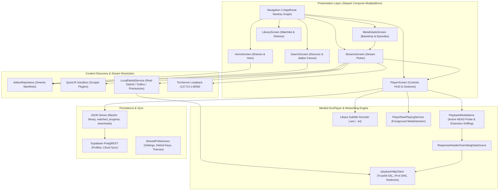

# Nuvio Architecture Reference: Executive Index & Reading Guide

This documentation suite provides a complete, source-grounded reverse-engineering specification of the **Nuvio** mobile application (`NuvioMobile`, Kotlin 2.4.10, Jetpack Compose Multiplatform 1.12.0) designed specifically to guide the architecture overhaul and playback pipeline implementation inside **Euthopiar** (`c:\Euthopiar`).

---

## 1. Table of Contents & Reading Order

The documentation is divided into focused architectural modules. For implementing playback inside Euthopiar, follow this reading order:

1. **[00_INDEX.md](file:///c:/Euthopiar/docs/nuvio-analysis/00_INDEX.md)** *(This document)*: Architecture overview, glossary, and reading guide.
2. **[03_content_and_playback_pipeline.md](file:///c:/Euthopiar/docs/nuvio-analysis/03_content_and_playback_pipeline.md)** *(Highest Priority)*: Complete tap-to-frames execution flow, stream resolution, custom ExoPlayer decoders, header injection, SSL bypass, TorrServer loopback, and playback error self-healing.
3. **[GAP_ANALYSIS.md](file:///c:/Euthopiar/docs/nuvio-analysis/GAP_ANALYSIS.md)** *(Implementation Roadmap)*: Direct line-by-line comparison between Nuvio and Euthopiar, explaining the 5 root causes of playback failure with actionable fix phases.
4. **[01_stack_and_structure.md](file:///c:/Euthopiar/docs/nuvio-analysis/01_stack_and_structure.md)**: Build configuration, Gradle plugins, AAR dependencies (custom Media3, QuickJS, libmpv, libass), SDK constraints, and product flavors (`full` vs `playstore`).
5. **[02_app_startup_and_navigation.md](file:///c:/Euthopiar/docs/nuvio-analysis/02_app_startup_and_navigation.md)**: Process lifecycle, `NuvioApplication`, storage registry initialization, `AppGate` profile selection, deep linking, and Navigation 3 route graph.
6. **[04_screens_home_and_details.md](file:///c:/Euthopiar/docs/nuvio-analysis/04_screens_home_and_details.md)**: Specification for `HomeScreen`, `MetaDetailsScreen`, and `CatalogScreen`.
7. **[04_screens_player_and_streams.md](file:///c:/Euthopiar/docs/nuvio-analysis/04_screens_player_and_streams.md)**: Specification for `StreamsScreen` (Stream picker modal) and `PlayerScreen` (Player HUD, gestures, PiP, subtitle picker).
8. **[04_screens_library_search_downloads.md](file:///c:/Euthopiar/docs/nuvio-analysis/04_screens_library_search_downloads.md)**: Specification for `SearchScreen`, `LibraryScreen`, `CollectionsScreen`, and `DownloadsScreen`.
9. **[04_screens_settings_and_profiles.md](file:///c:/Euthopiar/docs/nuvio-analysis/04_screens_settings_and_profiles.md)**: Complete profile security (PIN encryption) and all 11 sub-settings pages.
10. **[05_cross_cutting_systems.md](file:///c:/Euthopiar/docs/nuvio-analysis/05_cross_cutting_systems.md)**: Theming, tokens, Coil 3 image caching, foreground services, notifications, and self-updater.
11. **[06_data_models_and_storage.md](file:///c:/Euthopiar/docs/nuvio-analysis/06_data_models_and_storage.md)**: JSON schemas, Stremio protocols, Supabase database tables, and local file storage contracts.
12. **[COVERAGE_LEDGER.md](file:///c:/Euthopiar/docs/nuvio-analysis/COVERAGE_LEDGER.md)**: Exhaustive accounting ledger tracking all 1,152 source files across the codebase.

---

## 2. One-Page Architecture Overview

---

## 3. Glossary of Terms

- **Stremio Addon Protocol**: An HTTP JSON API contract standard where third-party providers serve manifests (`/manifest.json`), catalogs (`/catalog/{type}/{id}.json`), metadata (`/meta/{type}/{id}.json`), and stream lists (`/stream/{type}/{id}.json`).
- **Debrid Service**: Multi-host cloud unrestrict service (such as Real-Debrid, TorBox, Premiumize, AllDebrid, Debrid-Link) that converts torrent infoHashes or magnet links into direct, high-bandwidth HTTPS download links using remote seedbox caches.
- **Client-Resolve Stream**: A Stremio stream object returning `{ type: "debrid", infoHash: "...", isCached: true }` requiring the client application to query its own local Debrid API key rather than the addon server resolving the URL.
- **TorrServer**: An embedded Go/C++ binary running on local loopback (`127.0.0.1:8090`) that converts peer-to-peer torrent swarms into a sequential HTTP stream with read buffering.
- **QuickJS-kt**: Kotlin Multiplatform wrapper for Fabrice Bellard's lightweight QuickJS JavaScript engine, executing sandboxed scraper code without WebView overhead.
- **Libass**: Portable subtitle rendering library capable of rendering complex styling, animations, and karaoke effects in Advanced SubStation Alpha (`.ass`) subtitles natively.
- **Haze**: Compose glassmorphism library (`dev.chrisbanes.haze`) rendering GPU-accelerated background blurs beneath overlay sheets and navigation bars.
- **ResponseHeaderOverridingDataSource**: Custom AndroidX Media3 `DataSource` decorator that intercepts HTTP response headers and injects overridden headers (e.g. forcing `Content-Type: application/vnd.apple.mpegurl` on CDN links that serve `.m3u8` with generic octet-stream MIME types).
- **IPv4FirstDns**: Custom OkHttp DNS implementation that prioritizes IPv4 `A` records over IPv6 `AAAA` records to eliminate socket connection timeouts on cellular mobile networks.

---

## 4. Working Assumptions

1. **Source Immutability**: All analysis of Nuvio (`C:\Kently\Nuvio Apk\NuvioMobile`) is conducted strictly on a read-only basis without modifying files in the repository.
2. **Platform Target**: Euthopiar is targeted for modern Android devices running Android 7.0+ (API 24+) with Kotlin and Jetpack Compose.
3. **No General Knowledge Filling**: Every technical statement and architecture diagram in this specification is derived from actual code files and line numbers cited directly from the Nuvio codebase.
