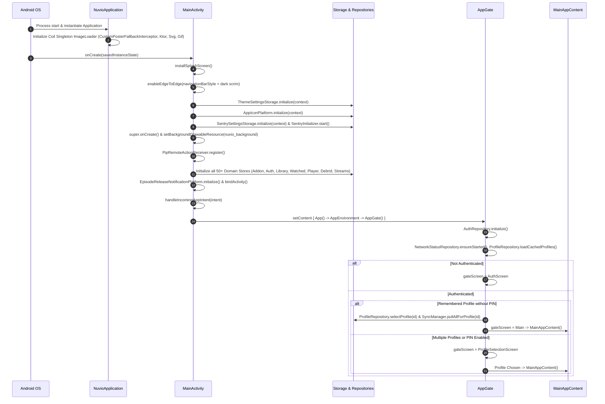

# 02. Application Startup, Lifecycle & Navigation Architecture

## 1. Process Startup & Initialization Sequence

Nuvio utilizes an explicit synchronous + asynchronous startup pipeline driven by Android's `Application`, `MainActivity`, and Compose `LaunchedEffect` coordinators. Rather than employing heavy reflection-based dependency injection frameworks like Hilt or Dagger, Nuvio uses a high-performance **Service Locator / Singleton Storage Pattern** with thread-safe lazy initializers and profile-scoped persistent stores.

### 1.1 Complete Step-by-Step Initialization Sequence
Ground truth citations: (`NuvioApplication.kt:22-44`, `MainActivity.kt:78-154`, `AppGate.kt:101-112`)



### 1.2 The Storage Initialization Registry
Ground truth citation: (`MainActivity.kt:85-148`)

In `MainActivity.onCreate`, storage singletons are initialized synchronously before Compose `setContent` is executed:
1. `ThemeSettingsStorage`: Loads active theme, AMOLED mode, custom colors, liquid glass tab bar preferences.
2. `AppIconPlatform`: Binds package manager for dynamic launcher activity-alias switching.
3. `SentrySettingsStorage` & `SentryInitializer`: Crash and error telemetry setup.
4. `SyncClientIdentityStorage`: Unique installation/client UUID for multi-device sync conflict resolution.
5. `AddonHttpClientProvider` & `AddonStorage`: Stremio addon HTTP client with caching, timeouts, and local addon JSON storage.
6. `AuthStorage`: Supabase session tokens, user ID, refresh tokens.
7. `ServerConfigurationStorage`: Remote streaming servers and endpoints.
8. `LibraryStorage`: Local saved watchlist, bookmarks, and custom shelves.
9. `WatchedStorage`: Watched episodes/movies bitsets, watch count, and series completion states.
10. `MetaScreenSettingsStorage`: Metadata screen configuration (poster transitions, hero trailer auto-play, cast display).
11. `EpisodeShuffleStorage`: Episode shuffle randomization history.
12. `HomeCatalogSettingsStorage`: Configured home rows, row ordering, and enabled catalog filters.
13. `PlayerSettingsStorage`: Player engine (ExoPlayer vs MPV), hardware decoding, audio boost, subtitle sizing, buffering preferences.
14. `PlayerTrackPreferenceStorage`: Preferred subtitle/audio languages and track selection flags.
15. `P2pSettingsStorage` & `P2pStreamingEngine`: TorrServer local/remote configuration, port, buffer size, DHT settings.
16. `ExternalPlayerPlatform`: Support for external players (VLC, MX Player, Just Player, Infuse).
17. `SubtitleFileCache`: Local caching directory for downloaded external `.srt` / `.ass` / `.vtt` subtitles.
18. `ProfileStorage`, `AvatarStorage`, `ProfilePinCacheStorage`: Multi-user profile management, custom avatars, and PIN security cache.
19. `MemberAssetStorage`: Supporter badges and premium assets.
20. `DiscoverSelectionStorage`: Search screen filter selections and active tags.
21. `SearchHistoryStorage`: Recent search queries and search history.
22. `SeasonViewModeStorage`: Grid vs list display modes for season episode pickers.
23. `PosterCardStyleStorage` & `CardDepthStyleStorage`: Poster card shapes, elevation, blur, depth effects.
24. `CustomPosterUrlStorage`: Overrides for custom poster URLs and scrapers.
25. `DebridSettingsStorage`: RealDebrid, AllDebrid, Premiumize, TorBox API tokens, download modes, and cloud settings.
26. `TmdbSettingsStorage`: TMDB API key and language/region preferences.
27. `MdbListSettingsStorage`, `PlatformMdbListAuthPersistence`, `PlatformMdbListSyncStorage`: MDBList integration and sync.
28. `TraktAuthStorage`, `TraktCommentsStorage`, `TraktLibraryStorage`, `TraktSettingsStorage`: Trakt.tv OAuth, scrobbling, comment threads.
29. `ServerStorage`: TorrServer instance configurations.
30. `SimklAuthStorage`, `SimklSyncStorage`: Simkl OAuth, scrobble history, watchlist sync.
31. `LibraryDisplaySettingsStorage`: Library sort orders, grid dimensions, badge displays.
32. `ContinueWatchingPreferencesStorage`, `ResumePromptStorage`, `ContinueWatchingEnrichmentStorage`: Resume thresholds, dialog prompts, artwork enrichment.
33. `EpisodeReleaseNotificationsStorage`: Episode release notification schedules and subscriptions.
34. `WatchProgressStorage`: Microsecond-precision playback resume positions and completion percentages.
35. `StreamLinkCacheStorage`: Temporary caching for resolved stream links to avoid re-resolving within TTL.
36. `StreamBadgeSettingsStorage`: Stream badges (4K, HDR, Dolby Vision, RD+, Seeders).
37. `BingeGroupCacheStorage`: Binge-watching group metadata to auto-advance episodes.
38. `PluginStorage`: Installed QuickJS scraper plugins and metadata.
39. `CollectionMobileSettingsStorage` & `CollectionStorage`: Custom user collections, folders, and items.
40. `DownloadsStorage`, `DownloadsPlatformDownloader`, `DownloadsLiveStatusPlatform`: Background download queues, status tracking, file management.
41. `AndroidAppUpdaterPlatform`: In-app APK updater and release check services.
42. `PlatformLocalAccountDataCleaner`: Data sanitizer when switching profiles or logging out.
43. `EpisodeReleaseNotificationPlatform`: Android notification channel registration and activity binding.

---

## 2. Intent Handling & Deep Link Routing

### 2.1 Intent Reception
Ground truth citation: (`MainActivity.kt:156-200`, `AppUrlBridge.kt:42-106`)

Incoming intents (`ACTION_VIEW`, `MAIN`, or custom schemes) enter via `MainActivity.onCreate` and `MainActivity.onNewIntent`, triggering `handleIncomingAppIntent(intent)`.
This calls `handleAppUrl(appUrl)` in `AppUrlBridge.kt`:

1. **Infuse / External Playback Return**: Checked first via `infusePlaybackCallbacks.handleUrl(normalizedUrl)`. If an external player returns progress via URL callback, it records progress and returns.
2. **Scrobble Auth Callbacks**: `TrackingProviderRegistry.handleAuthCallback(normalizedUrl)` intercepts OAuth redirects:
   - `nuvio://auth/simkl` -> Extracts authorization code and exchanges for Simkl session.
   - `nuvio://auth/trakt` -> Extracts authorization code and exchanges for Trakt access token.
3. **App Deep Link Resolution**: `AppDeepLinkRepository.handleUrl(normalizedUrl)` parses the URL into `AppDeepLink` sealed types:
   - **`AppDeepLink.Meta(type, id)`**:
     - `nuvio://meta?type={movie|series}&id={id}`
     - `nuvio://movie/{id}` or `nuvio://series/{id}`
     - `nuvio://details/{type}/{id}`
     - `nuvio://imdb/{type}/{imdbId}`
     - `nuvio://tmdb/{type}/{tmdbId}`
   - **`AppDeepLink.AddonInstall(manifestUrl)`**:
     - `stremio://{host}/manifest.json` -> Normalizes to `https://{host}/manifest.json`
     - `nuvio://{host}/manifest.json` -> Normalizes to `https://{host}/manifest.json`
   - **`AppDeepLink.Downloads`**:
     - `nuvio://downloads` -> Navigates to downloads screen.

Deep links are published to `AppDeepLinkRepository.pendingDeepLink: StateFlow<AppDeepLink?>`, which `MainAppContent` observes and dispatches to `navController.navigate()`.

---

## 3. The AppGate Lifecycle State Machine

Ground truth citation: (`AppGate.kt:47-280`)

The application entrance is protected by `AppGate`. The gate state is governed by `AppGateScreen`:
- `Loading`: Initial checking phase while auth tokens, network, and cached profiles are queried.
- `Auth`: Rendered if no authenticated session exists. Displays `AuthScreen` (email login, guest mode, device link QR code).
- `ProfileSelection`: Rendered when authenticated if profile selection is required. Displays `ProfileSelectionScreen` (profile cards, avatar icons, PIN unlock modal).
- `ProfileEdit`: Rendered when creating or modifying a profile (`ProfileEditScreen`).
- `Main`: Rendered once an active profile is established. Mounts `MainAppContent`.

### 3.1 Remembered Profile Auto-Skip Logic
Ground truth citation: (`AppGate.kt:240-279`)

Upon app start, `enterProfileGate` evaluates:
```kotlin
val currentProfileState = ProfileRepository.state.value
if (currentProfileState.rememberLastProfileEnabled && currentProfileState.hasEverSelectedProfile) {
    val remembered = profiles.find { it.profileIndex == ProfileRepository.activeProfileId }
    if (remembered != null && !remembered.pinEnabled) {
        // Auto-select and skip profile screen
        selectProfile(remembered, sync = true)
        gateScreen = AppGateScreen.Main.name
    }
}
```
If a profile has `pinEnabled = true`, auto-skip is prohibited, forcing the user through `ProfileSelectionScreen` to input their 4-digit PIN before decrypting or accessing the profile.

---

## 4. Complete Navigation Graph & Route Specification

Nuvio employs **AndroidX Navigation 3** (`androidx.navigation3.runtime`, `androidx.navigation3.ui.NavDisplay`), using typesafe sealed interface `AppRoute : NavKey` (`Routes.kt:7-25`).

### 4.1 Route Catalog Table
Ground truth citations: (`Routes.kt:27-153`, `MainAppContent.kt:1253-1600`)

| Route Name | Arguments & Types | Parent / Preferred Tab | Hides Nav Bar | Transitions & Visual Specs |
| :--- | :--- | :--- | :--- | :--- |
| `TabsRoute` | None | Root (Home/Search/Library/Settings) | No | Default crossfade / tab slide |
| `DetailRoute` | `type: String`<br>`id: String`<br>`title: String?` | Any (Pushed onto current stack) | No | Shared element poster transition (`PosterNavigationMotion`), slide-up |
| `PersonDetailRoute` | `personId: Int`<br>`personName: String`<br>`personPhoto: String?`<br>`castAvatarTransitionKey: String?`<br>`preferCrew: Boolean` | Detail screen | No | Shared avatar transition, slide-in from right |
| `EntityBrowseRoute` | `entityKind: String`<br>`entityId: Int`<br>`entityName: String`<br>`sourceType: String` | Detail screen | No | Slide-in from right |
| `StreamRoute` | `launchId: Long`<br>`title: String` | Detail / Continue Watching | No (forces landscape if set) | Slide-up sheet / loading overlay |
| `PlayerRoute` | `launchId: Long`<br>`title: String` | Stream screen / Direct play | **Yes** (`hidesNavigationBar = true`) | Fade (220ms), locks landscape, immersive fullscreen |
| `CatalogRoute` | `launchId: Long`<br>`title: String`<br>`subtitle: String?` | Home / Library "View All" | No | Slide-in from right |
| `DownloadsRoute` | `title: String` | Preferred Tab: `Library` | No | Slide-in from right |
| `DownloadShowRoute` | `showId: String`<br>`title: String` | Downloads screen | No | Slide-in from right |
| `AddonsSettingsRoute` | `title: String` | Preferred Tab: `Settings` | No | Slide-in from right |
| `PluginsSettingsRoute` | `title: String` | Preferred Tab: `Settings` | No | Slide-in from right |
| `HomescreenSettingsRoute`| `title: String` | Preferred Tab: `Settings` | No | Slide-in from right |
| `MetaScreenSettingsRoute`| `title: String` | Preferred Tab: `Settings` | No | Slide-in from right |
| `ContinueWatchingSettingsRoute`| `title: String`| Preferred Tab: `Settings` | No | Slide-in from right |
| `AccountSettingsRoute` | `title: String` | Preferred Tab: `Settings` | No | Slide-in from right |
| `CollectionsRoute` | `title: String` | Preferred Tab: `Settings` | No | Slide-in from right |
| `CollectionEditorRoute`| `collectionId: String?`<br>`title: String`| Collections | No | Slide-up modal |
| `CollectionEditorPageRoute`| `collectionId: String?`<br>`pageName: String`<br>`title: String`| Collection Editor | No | Slide-in from right |
| `FolderDetailRoute` | `collectionId: String`<br>`folderId: String`<br>`title: String`| Collections | No | Slide-in from right |
| `SupportersContributorsSettingsRoute`| `title: String`| Preferred Tab: `Settings` | No | Slide-in from right |
| `LicensesAttributionsSettingsRoute`| `title: String`| Preferred Tab: `Settings` | No | Slide-in from right |
| `SettingsPageRoute` | `pageName: String`<br>`title: String` | Preferred Tab: `Settings` | No | Slide-in from right |

### 4.2 Back-Stack Management & Memory Disposal
Ground truth citation: (`NuvioNavigator.kt:21-65`, `MainAppContent.kt:213-217`)

1. **`NuvioNavigator`**: Wraps `NavBackStack<NavKey>` and provides:
   - `navigate(route, options)` with optional `launchSingleTop = true` to avoid duplicate routes on double-taps.
   - `popUpTo<T>(inclusive = Boolean)` to clear intermediate flows (e.g. popping from `StreamRoute` directly back to `DetailRoute` or replacing into `PlayerRoute`).
2. **`RouteDisposalNavEntryDecorator`**:
   Decorates navigation entries and invokes `disposeRoute(key)` as soon as an entry is popped off the back-stack. This releases memory caches, unbinds poster textures, and cancels pending coroutine jobs associated with that route.

---

## 5. Global State Flow & Concurrency Model

### 5.1 Unidirectional Data Flow (UDF)
Every feature repository in Nuvio follows a strict UDF pattern:
- **Private State**: `private val _state = MutableStateFlow(InitialState)`
- **Public Flow**: `val state: StateFlow<State> = _state.asStateFlow()`
- **UI Observation**: Compose views collect states using `collectAsStateWithLifecycle()` from `androidx.lifecycle.compose`. This guarantees that state collectors stop observing when the screen is in the background or during configuration changes.

### 5.2 Threading & Dispatchers
- **`Dispatchers.Main`**: Drives UI rendering, Navigation 3 back-stack updates, and Compose state transitions.
- **`Dispatchers.IO`**: Used for all disk I/O, SQLite/SharedPreferences persistence, OkHttp network calls, and Ktor client executions.
- **`ConflatedTaskDispatcher`** (`core/concurrent/ConflatedTaskDispatcher.kt:1-60`): Custom dispatcher utility that cancels prior running tasks when a new task arrives with the same key (e.g. rapid search typing or scraping cancellations).

### 5.3 Multi-Profile Scoping
All application preferences and tracking data are partitioned by `profileIndex`:
`ProfileScopedKey.kt`: Keys in SharedPreferences or local JSON stores are prefixed with `profile_{index}_{key}`. When a user switches profiles, `ProfileRepository.selectProfile(index)` re-binds the active key scope and triggers `SyncManager.pullAllForProfile(index)` to load that profile's unique library, watched marks, and resume positions.
