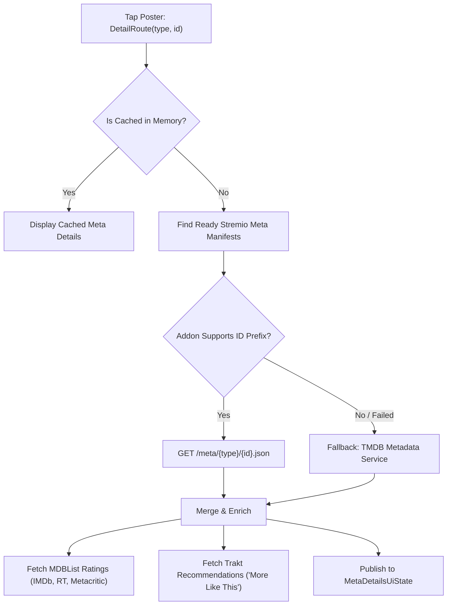

# 03. Content Discovery, Stream Resolution & Media Playback Pipeline

> **HIGHEST PRIORITY ARCHITECTURAL REFERENCE**  
> This document details the exact, ground-truth mechanics of how Nuvio discovers catalog content, fetches metadata, queries scraping providers and Stremio addons, resolves Debrid and BitTorrent streams, configures the video playback engines (ExoPlayer & MPV), injects network headers, manages subtitles, and handles playback errors and state recovery.

---

## 1. Catalog & Home Rows Architecture

### 1.1 Catalog Sources & Discovery
Ground truth citations: (`HomeRepository.kt:50-145`, `HomeCatalogSettingsRepository.kt:1-90`, `CatalogRepository.kt:1-120`)

Home screen content rows originate from three distinct data sources:
1. **Installed Stremio Addons (`manifest.catalogs`)**: Every enabled addon with `resources: ["catalog"]` exports one or more catalog definitions specifying `type` (movie, series, anime, other), `id` (e.g. `top`, `trending`, `popular`), and optional `extra` parameters (genre, skip).
2. **User Collections & Custom Shelves**: Custom user lists created in `CollectionRepository`, populated with TMDB lists or Trakt user lists.
3. **Local / Remote TorrServer Catalogs**: Configured media servers exporting browsable sections.

### 1.2 Fetching, Concurrency, Batching & Caching
Ground truth citation: (`HomeRepository.kt:80-135`)
- **Batching**: Catalog definitions are prioritized according to `HomeCatalogSettingsRepository` and chunked into batches of `HOME_CATALOG_FETCH_BATCH_SIZE = 4`.
- **Concurrency**: Within each batch, requests run concurrently using `batch.map { async { request.toSection(forceRefresh) } }.awaitAll()`.
- **Incremental Publishing**: Rather than waiting for all rows to load, `publishCurrentState()` is triggered after the first batch and then every `HOME_CATALOG_PUBLISH_INTERVAL = 2` batches, ensuring posters render within milliseconds.
- **Memory & Disk Caching**: Loaded catalog rows are held in `cachedSections: Map<String, HomeCatalogSection>`. Poster URLs pass through `CustomPosterUrlRepository` to apply user-customized artwork.
- **Pagination**: Full-page catalog views (`CatalogRoute`) load pages via `fetchCatalogPage` using `skip={offset}` query parameters in steps of 20 or 100 items depending on addon manifests.

---

## 2. Metadata & Detail Resolution Pipeline

Ground truth citations: (`MetaDetailsRepository.kt:58-150`, `TmdbMetadataService.kt:1-85`, `MdbListMetadataService.kt:1-60`)

When a user taps a poster, navigation triggers `DetailRoute(type, id)` and invokes `MetaDetailsRepository.load(type, id)`.



### 2.1 Stremio Manifest ID Matching & Fallback
1. **Addon Resolution**: `findReadyMetaManifests(type, id)` filters installed addons that declare `resources: ["meta"]`, match the requested `type`, and match `idPrefixes` (e.g. `tt` for IMDb IDs, `tmdb:` for TMDB IDs).
2. **HTTP Fetch**: Calls `fetchAddonResponseText(url = "{transportUrl}/meta/{type}/{id}.json")`.
3. **TMDB Fallback**: If no addons are installed, or if the addon request times out or returns HTTP 404/500, `tryFetchTmdbFallbackMeta(type, id)` makes a direct REST call to TMDB (`/movie/{id}` or `/tv/{id}` with `append_to_response=credits,videos,external_ids,recommendations`).
4. **Metadata Enrichment**:
   - `MdbListMetadataService`: Fetches Rotten Tomatoes critics/audience scores, Metacritic ratings, and IMDb votes.
   - `ImdbEpisodeRatingsConfig`: Fetches individual episode ratings to display color-coded quality pills in the episode guide.
   - `TraktRelatedRepository`: Queries Trakt algorithm recommendations for the "More Like This" shelf.

---

## 3. Providers, Addons & Scrapers Pipeline

Nuvio supports two scraper architectures: **Stremio HTTP Addons** and **QuickJS JavaScript Plugins**.

### 3.1 Stremio Addon Engine
Ground truth citations: (`AddonHttpClient.kt:1-120`, `AddonRepository.kt:1-200`, `StreamParser.kt:1-180`)

- **Manifest Request**: `GET {addonUrl}/manifest.json`
- **Stream Request Format**:  
  `GET {addonTransportUrl}/stream/{type}/{id}.json`
  - For Movies: `.../stream/movie/tt1375666.json`
  - For Series Episodes: `.../stream/series/tt0903747:1:1.json` (`{imdbId}:{season}:{episode}`)
- **Addon Stream Response Shape**:
```json
{
  "streams": [
    {
      "name": "Torrentio\n1080p",
      "title": "Inception.2010.1080p.BluRay.x264\n💾 2.4 GB 👤 142 ⚙️ RD+",
      "url": "https://real-debrid.com/d/...",
      "infoHash": "c12fe1c06bba254a9dc9f519b335380dc74234c0",
      "fileIdx": 0,
      "behaviorHints": {
        "defaultHeaders": {
          "User-Agent": "Mozilla/5.0...",
          "Referer": "https://..."
        },
        "notWebReady": false,
        "bingeGroup": "inception-1080p"
      }
    }
  ]
}
```

### 3.2 QuickJS JavaScript Scraper Plugins (`full` Distribution)
Ground truth citations: (`PluginRepository.kt:70-150`, `PluginRuntime.kt:40-140`, `JsBindings.kt:1-90`)

- **Sandboxed Virtual Machine**: Embedded QuickJS engine (`quickjs-kt-android-1.0.5-nuvio.aar`).
- **Concurrency & Resource Limits**:
  - `MAX_CONCURRENT_PLUGINS = 10` enforced via coroutine `Semaphore`.
  - Hard execution timeout: `PLUGIN_TIMEOUT_MS = 60_000L` (60 seconds).
- **Injected Host Runtime Bridges**:
  - `HostFunctions`: Logs, local persistent scraper storage (`getSettings`, `setSettings`), and result callback `onResult(json)`.
  - `FetchBridge`: Polyfills standard `fetch(url, options)` supporting GET, POST, custom headers, cookies, redirects, and binary buffers.
  - `UrlBridge`: Polyfills `URL` and `URLSearchParams`.
  - `CryptoBridge`: Exposes native AES-CBC, AES-GCM, MD5, SHA-256, and HMAC hashing routines.
  - `DomBridge`: Exposes Ksoup DOM engine (`DOMParser`, `querySelector`, `querySelectorAll`, `getAttribute`, `textContent`).
  - `WasmBridge`: Enables running compiled WebAssembly modules inside the JS sandbox.
- **Scraper Invocation**: Calls entry point `scraper({ tmdbId, mediaType, season, episode })` and parses returned stream candidate objects.

---

## 4. Stream & Source Resolution Pipeline

Ground truth citations: (`StreamsRepository.kt:239-500`, `DirectDebridResolver.kt:25-180`, `DirectDebridStreamPreparer.kt:20-160`, `StreamAutoPlaySelector.kt:1-220`)

When a user initiates playback (or enters `StreamRoute`), `StreamsRepository.load()` coordinates stream gathering:

### 4.1 Concurrent Query Execution
`StreamsRepository` launches concurrent coroutines across:
1. Every installed Stremio stream addon (`streamAddons.forEach { launch { ... } }`)
2. Every active QuickJS scraper plugin (`pluginScrapers.forEach { launch { ... } }`)
3. Remote / local TorrServer instances (`serverSources.forEach { launch { ... } }`)

As each provider responds, results are streamed through `Channel<StreamLoadCompletion>(capacity = Channel.BUFFERED)` and integrated into `_uiState`.

### 4.2 Debrid Cache Inspection & Pre-Preparation
Ground truth citation: (`LocalDebridAvailabilityService.kt:1-95`, `DirectDebridStreamPreparer.kt:20-65`)

1. **Instant Cache Check**: When torrent streams (`infoHash`) arrive, `LocalDebridAvailabilityService.annotateCachedAvailability()` checks if the hash is cached on the user's active Debrid provider (RealDebrid, TorBox, AllDebrid, Premiumize). If cached, the stream receives an instant badge (e.g. `[RD+]`, `[TB+]`).
2. **Background Pre-Resolution**: `DirectDebridStreamPreparer` identifies the top candidates (or auto-play selection) and resolves them into direct HTTP CDN URLs **in the background** before the user even taps the card!
   - Throttled by a rate limiter (`MAX_BACKGROUND_PREPARES_PER_MINUTE = 6`).
   - Resolved links are cached in `DirectDebridPlaybackResolver` (`DEBRID_RESOLVE_CACHE_TTL_MS = 15 minutes`).

### 4.3 Ranking, Filtering & Auto-Play Selection
Ground truth citation: (`StreamAutoPlaySelector.kt:1-220`)
- **Sorting Hierarchy**:
  1. Debrid Cached Streams (`RD+`, `TorBox+`, `AllDebrid+`)
  2. Resolution (4K / 2160p > 1080p > 720p > SD)
  3. Codec & Dynamic Range (Dolby Vision / HDR10+ / HEVC / AV1 > SDR)
  4. Audio Profile (Atmos / TrueHD / DTS-HD / 7.1 > 5.1 > Stereo)
  5. Seeder Count (for P2P torrents) / Bitrate / File Size
- **Auto-Play Modes**:
  - `FIRST_SOURCE`: Plays the highest-ranked candidate automatically.
  - `REGEX_MATCH`: Matches regex against file title/codec (e.g. `(?i)1080p.*(dovi|hdr)`).
  - `BINGE_GROUP`: Reuses the exact same release group/uploader matching the previously watched episode from `BingeGroupCacheRepository`.

---

## 5. Video Player Architecture & Media Source Construction

Ground truth citations: (`PlayerEngine.android.kt:138-466`, `PlayerPlaybackNetworking.kt:21-170`, `PlaybackMediaItems.android.kt:9-197`, `ResponseHeaderOverridingDataSource.kt:8-51`)

### 5.1 Dual Playback Engine Architecture
Nuvio provides two video playback engines on Android:
1. **Primary Engine**: Custom **ExoPlayer (Media3 1.8.0)** enhanced with prebuilt native AAR decoders (`lib-decoder-ffmpeg`, `lib-decoder-av1`, `lib-decoder-mpegh`, `lib-nuvio-engine-android`).
2. **Secondary / Fallback Engine**: Embedded **libmpv (`MPVKit` / `mpv-android-lib 0.1.12`)**. If ExoPlayer fails due to an unsupported codec or container corruption, `PlayerEngine.android.kt:156-163` automatically falls back to `libmpv` without interrupting the user.

### 5.2 Network Resilience & OkHttp DataSource
Ground truth citation: (`PlayerPlaybackNetworking.kt:46-115`)

Standard Android media players fail because of strict network defaults. Nuvio bypasses these failure modes via `PlayerPlaybackNetworking.playbackHttpClient`:
- **IPv4-First DNS**: `IPv4FirstDns()` forces DNS queries to prefer IPv4 addresses, avoiding carrier network IPv6 routing stalls.
- **Trust-All SSL**: Configured with `trustAllManager` and `HostnameVerifier { _, _ -> true }`. This prevents SSL handshake failures on self-signed proxies, Debrid CDNs, and media server hosts.
- **Cross-Protocol Redirects**: `followRedirects(true)` and `followSslRedirects(true)` allow HTTP to HTTPS edge redirects.
- **Extended Loopback Timeout**: When connecting to local TorrServer (`127.0.0.1:8090`), read timeout is extended to **65 seconds** (`loopbackPlaybackHttpClient`), allowing torrent swarms sufficient time to connect and buffer the initial chunk.
- **Browser User-Agent Injection**: Sets desktop/mobile Chrome User-Agent (`DEFAULT_USER_AGENT`) on every HTTP stream request and forwards custom headers (`Referer`, `Authorization`, cookies).

### 5.3 MIME Type Inference & Response Header Overriding
Ground truth citation: (`PlaybackMediaItems.android.kt:23-136`, `ResponseHeaderOverridingDataSource.kt:35-45`)

Many video hosts serve streams with missing or incorrect headers (e.g. returning `Content-Type: text/plain` for an HLS playlist or MP4). Nuvio handles this via:
1. `inferPlaybackMimeType`: Inspects `streamType`, `Content-Type`, `Content-Disposition`, file extensions (`.m3u8`, `.mpd`, `.mkv`, `.mp4`), URL query params (`?format=m3u8`), and delimited regex tokens.
2. `probeMimeType`: Issues a lightweight `HEAD`/`GET` probe (3s timeout) to determine the real container.
3. `ResponseHeaderOverridingDataSource`: Wraps the data source and injects expected response headers into ExoPlayer so the correct demuxer (`HlsMediaSource`, `DashMediaSource`, or `ProgressiveMediaSource`) is instantiated.

### 5.4 Advanced Codec & Subtitle Processing
- **Dolby Vision Profile 7 Mapping**: `setMapDV7ToHevc(playerSettings.mapDV7ToHevc)` converts incompatible DV7 metadata to HDR10, preventing black screen freezes.
- **FFmpeg Audio Decoders**: Software decoding fallback for DTS-HD, TrueHD, AC3, and E-AC3.
- **Pixel-Perfect Subtitles**: Integrates `AssSubtitleView` (`io.github.peerless2012:ass-media`) backed by native `libass` to render complex styled ASS/SSA anime subtitles directly on top of ExoPlayer.

---

## 6. Playback Progress, Resume & Scrobbling

Ground truth citations: (`PlayerScreenRuntimePlaybackActions.kt:277-432`, `WatchProgressRepository.kt:1-140`, `WatchProgressStorage.kt:1-90`)

### 6.1 State Persistence Timing
Playback progress is captured via `PlayerPlaybackSnapshot` and persisted:
- **Periodic Interval**: Every `PlaybackProgressPersistIntervalMs = 5,000L` (5 seconds) during active playback.
- **Lifecycle Events**: Immediately upon Seek, Pause, Episode Change, Backgrounding, and Screen Exit (`flushWatchProgress()`).

### 6.2 The 80% Completion Rule
Ground truth citation: (`PlayerScreenRuntimePlaybackActions.kt:280-295`)
- **Resumable Range (`1% <= progress < 80%`)**: Saved to `WatchProgressStorage` with exact microsecond position `lastPositionMs` and `progressFraction`. Rendered on the Home screen in the **"Continue Watching"** carousel.
- **Completed Range (`progress >= 80%`)**: Marked as fully watched in `WatchedRepository`. Triggers `emitTrackingScrobbleStop` to Trakt.tv and Simkl, marking the media item as watched and removing it from the continue watching queue.

---

## 7. Failure Paths & Self-Healing Logic

Ground truth citations: (`PlayerScreenRuntimeUi.kt:192-205`, `PlayerScreenRuntimeSourceActions.kt:28-52`, `DirectDebridResolver.kt:133-145`)

| Failure Condition | Root Cause | Nuvio Self-Healing Mechanism |
| :--- | :--- | :--- |
| **Expired Debrid Link** | RealDebrid CDN tokens expire after hours | `tryRefreshCredentialedSourceAfterError()` detects 401/403, calls `DirectDebridPlaybackResolver.resolveToPlayableStream()` for a fresh CDN token, and restarts playback seamlessly without exiting player. |
| **Dead Stream / HTTP 404** | Torrent seeder died or host deleted file | `removeFailedStreamFromCache()` purges the link from `StreamLinkCacheStorage`, reveals error overlay, and offers a 1-tap "Play Next Ranked Source" fallback. |
| **Codec Decode Failure** | Android MediaCodec fails on proprietary profile | `PlayerEngine.android.kt:156` intercepts `PlaybackException`, switches active engine from `ExoPlayer` to `libmpv`, and resumes playback at the exact same position timestamp. |
| **Slow TorrServer Swarm** | Torrent peers taking >20s to connect | `loopbackPlaybackHttpClient` uses a 65-second read timeout, preventing early socket close while TorrServer pre-allocates pieces. |

---

## 8. Numbered Step-by-Step Sequence: Tap to Frames

The following numbered list traces the exact journey from user touch to hardware decoding:

1. **User Taps Poster**: `onPosterClick` dispatches `DetailRoute(type = "movie", id = "tt1375666")`.
2. **Metadata Presentation**: `MetaDetailsRepository.load` checks memory cache; if missing, issues concurrent GET to addon `/meta/{type}/{id}.json`, with TMDB REST API fallback.
3. **User Taps "Play"**: `onPlay` evaluates `launchPlaybackWithDownloadPreference`. Checks local downloads via `DownloadsRepository.findPlayableDownload`; if absent, constructs `StreamLaunch` and navigates to `StreamRoute`.
4. **Provider Fan-Out**: `StreamsRepository.load` launches parallel coroutines across all enabled Stremio addons (`/stream/{type}/{id}.json`) and QuickJS scraper plugins.
5. **Real-Time Stream Parsing**: `StreamParser.parse` converts payloads into `StreamItem` objects; badges are attached (`StreamBadgePresentation`).
6. **Debrid Cache Check**: `LocalDebridAvailabilityService` checks if torrent hashes are cached on RealDebrid/TorBox/AllDebrid and attaches `[RD+]` badges.
7. **Background Pre-Resolution**: `DirectDebridStreamPreparer` immediately takes the top stream candidate and unrestricts it with the Debrid provider API in the background.
8. **Auto-Play / User Selection**: Either auto-play policy settles on the top stream or user taps a stream card.
9. **Player Launch State Creation**: `PlayerLaunch` is created containing direct stream URL, HTTP request headers (User-Agent, Referer), response headers, subtitle links, and resume position from `WatchProgressRepository`. Stored in `PlayerLaunchStore`.
10. **Navigation to Player**: Navigates to `PlayerRoute(launchId)`. System bars are hidden (`HidePlayerSystemBars`), screen is locked to landscape (`LockPlayerToLandscape`).
11. **Engine Setup**: `ExoPlayerSurface` instantiates `ExoPlayer` with custom `DefaultRenderersFactory` (FFmpeg decoders enabled, DV7 mapped to HEVC, Libass subtitle view attached).
12. **Networking Pipeline**: `PlatformPlaybackDataSourceFactory` creates OkHttp DataSource with `IPv4FirstDns`, trust-all SSL, and custom User-Agent.
13. **MIME Detection & Demuxing**: `inferPlaybackMimeType` detects stream format; `ResponseHeaderOverridingDataSource` guarantees the demuxer recognizes the playlist/container.
14. **Playback & Resumption**: Player seeks to `initialPositionMs`, begins hardware/software decoding, and starts periodic 5s progress reporting to `WatchProgressRepository`.
