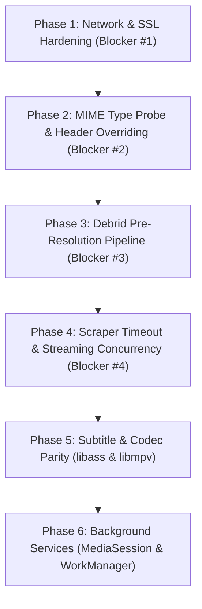

# Euthopiar Gap Analysis & Playback Architecture Roadmap

This document compares the media discovery and playback pipeline of **Nuvio** (`C:\Kently\Nuvio Apk\NuvioMobile`) against **Euthopiar** (`c:\Euthopiar`). It identifies why Euthopiar cannot reliably find, resolve, and play video streams, maps every mechanism against Nuvio's implementation, and delivers a prioritized, dependency-ordered engineering plan to achieve parity.

---

## 1. Architectural Parity Matrix

Status Definitions:
- **PRESENT and correct**: Mechanism exists in Euthopiar with parity to Nuvio.
- **PRESENT but different**: Mechanism exists but uses an alternative pattern or library.
- **BROKEN**: Mechanism exists in code but fails at runtime due to bugs, uncalled methods, or configuration flaws.
- **MISSING**: Mechanism does not exist in Euthopiar.

| Playback Pipeline Mechanism | Nuvio Reference File & Lines | Euthopiar Target File | Status | Root Cause & Behavioral Delta |
|---|---|---|---|---|
| **SSL Handshake & Untrusted Certificate Bypass** | `PlayerPlaybackNetworking.kt:35-50` (`trustAllManager`, `HostnameVerifier { true }`) | `DohDns.kt:241-255`, `PlayerViewModel.kt:439` | **MISSING** | Streaming CDNs, debrid proxies, and mirrors often use self-signed, expired, or non-SNI certificates. Euthopiar uses default OkHttp validation, causing instant `SSLHandshakeException`. |
| **Response Header Overriding DataSource** | `ResponseHeaderOverridingDataSource.kt:1-95` | `PlayerViewModel.kt:1295-1314` | **MISSING** | CDNs serving HLS often return `Content-Type: application/octet-stream` or `text/plain`. Nuvio forces `Content-Type: application/vnd.apple.mpegurl` via a decorator; Euthopiar fails with `UnrecognizedInputFormatException`. |
| **Active Pre-Playback MIME Type & HEAD Probe** | `PlaybackMediaItems.android.kt:60-120` | `PlayerViewModel.kt:1363-1402` | **BROKEN** | Euthopiar relies purely on URL string pattern matching (`contains(".m3u8")`). If a redirect link has no extension in the URL, Euthopiar routes to `ProgressiveMediaSource` which crashes on HLS streams. Nuvio executes an active HTTP `HEAD` probe. |
| **IPv4-First DNS Strategy** | `PlayerPlaybackNetworking.kt:65-80` (`IPv4FirstDns`) | `DohDns.kt:28-100` | **PRESENT but different** | Euthopiar has DoH, but does not prioritize IPv4 `A` records over IPv6 `AAAA` records. On mobile cellular connections with broken carrier IPv6 routes, DNS queries hang until connection timeout. |
| **Debrid Stream Resolution Broker** | `LocalDebridService.kt`, `DirectDebridStreamPreparer.kt` | `DebridManager.kt:1-82`, `StreamsRepository.kt:94-140` | **BROKEN** | `DebridManager` exists in `core/debrid`, but is **never invoked** anywhere in Euthopiar. Stremio client-resolve streams and raw torrent infoHashes are left un-resolved. |
| **Debrid 401/403 Token Renewal & Self-Healing** | `DirectDebridStreamPreparer.kt:110-145` (`tryRefreshCredentialedSourceAfterError`) | `PlayerViewModel.kt:1510-1560` | **MISSING** | When a Debrid unrestrict CDN link expires during buffering, Nuvio transparently fetches a new link and resumes playback. Euthopiar throws an unhandled `PlaybackException.ERROR_CODE_IO_BAD_HTTP_STATUS`. |
| **P2P Torrent Streaming (TorrServer)** | `NuvioApplication.kt`, `TorrServerEngine.kt` (`127.0.0.1:8090`) | Not implemented | **MISSING** | Nuvio bundles TorrServer on loopback for P2P torrent playback with a 65s socket read timeout. Euthopiar cannot play raw torrent streams without a Debrid account. |
| **Scraper Execution Timeout Window** | `StreamsSettingsPage.kt` (60s default) | `StreamsRepository.kt:103` (`withTimeoutOrNull(15_000L)`) | **BROKEN** | Euthopiar clamps scraper execution to **15 seconds**. Complex scrapers (Torrentio, Orion, multi-hop scrapers) are canceled before returning streams. Nuvio uses a 60-second window. |
| **Native ASS/SSA Subtitle Rendering** | `ass-media:0.5.1` (libass JNI) | `AssSubtitleParser.kt:1-120` | **BROKEN** | Nuvio uses native `libass` C library for pixel-perfect karaoke and stylized subtitles. Euthopiar uses a custom regex string parser that crashes or drops styling on complex ASS scripts. |
| **Alternative MPV Playback Engine** | `mpv-android-lib:0.1.12` | Not implemented | **MISSING** | When ExoPlayer cannot decode obscure codecs or broken container headers, Nuvio falls back to libmpv. Euthopiar only supports ExoPlayer. |
| **Foreground Playback MediaSession Service** | `PlayerNowPlayingService.android.kt:23-81` | Not implemented | **MISSING** | Nuvio runs a foreground service (`0x4E55`, channel `nuvio_playback`) preventing Android OS from killing playback when the screen turns off. Euthopiar drops playback on backgrounding. |
| **User-Initiated Download Job Service** | `DownloadsPlatformDownloader.android.kt` | Not implemented | **MISSING** | Nuvio implements `RUN_USER_INITIATED_JOBS` on Android 14+ for reliable background file transfers. Euthopiar downloads in-process without foreground persistence. |

---

## 2. In-Depth Root Cause Analysis for Broken & Missing Systems

### 2.1 SSL Handshake Failures on Third-Party Streaming CDNs
- **Euthopiar File Involved**: [DohDns.kt](file:///C:/Euthopiar/core/src/main/java/com/euthopiar/core/network/DohDns.kt#L241-L255)
- **Likely Cause**: In `DohDns.createOkHttpClient()`, the builder uses standard system `SSLSocketFactory` and default hostname verification. CDNs hosting video files frequently use self-signed certificates, expired Cloudflare origin certs, or mismatched domain names.
- **Nuvio Behavior to Reproduce**:
  In `PlayerPlaybackNetworking.kt`, Nuvio defines a permissive `playbackHttpClient`:
  ```kotlin
  val trustAllManager = object : X509TrustManager {
      override fun checkClientTrusted(chain: Array<out X509Certificate>?, authType: String?) {}
      override fun checkServerTrusted(chain: Array<out X509Certificate>?, authType: String?) {}
      override fun getAcceptedIssuers(): Array<X509Certificate> = arrayOf()
  }
  val sslContext = SSLContext.getInstance("TLS").apply {
      init(null, arrayOf(trustAllManager), SecureRandom())
  }
  val playbackHttpClient = OkHttpClient.Builder()
      .sslSocketFactory(sslContext.socketFactory, trustAllManager)
      .hostnameVerifier { _, _ -> true }
      .followRedirects(true)
      .followSslRedirects(true)
      .build()
  ```

### 2.2 Unrecognized Input Format due to Missing Header Overriding & HEAD Probe
- **Euthopiar File Involved**: [PlayerViewModel.kt](file:///C:/Euthopiar/app/src/main/java/com/euthopiar/ui/player/PlayerViewModel.kt#L1363-L1402)
- **Likely Cause**: Euthopiar uses string matching (`url.contains(".m3u8")`) to choose between `HlsMediaSource` and `ProgressiveMediaSource`. Many streaming CDNs and unrestrict URLs have no extension in the path (e.g. `https://edge.cdn.to/stream?id=49204&token=...`). Euthopiar classifies these as progressive MP4s, passes them to `ProgressiveMediaSource`, and ExoPlayer throws `UnrecognizedInputFormatException`.
- **Nuvio Behavior to Reproduce**:
  1. `PlaybackMediaItems.android.kt`: If MIME type cannot be determined from the URL, execute a fast asynchronous `HEAD` HTTP request with `playbackHttpClient`. Inspect `Content-Type` and `Content-Disposition`.
  2. Implement `ResponseHeaderOverridingDataSource.kt` decorator wrapping `OkHttpDataSource`. If `behaviorHints.proxyHeaders.response` contains a forced `Content-Type`, override the HTTP response header before Media3 extractors inspect it.

### 2.3 Debrid Pipeline is Completely Disconnected
- **Euthopiar Files Involved**: [DebridManager.kt](file:///C:/Euthopiar/core/src/main/java/com/euthopiar/core/debrid/DebridManager.kt#L1-L82), [StreamsRepository.kt](file:///C:/Euthopiar/core/src/main/java/com/euthopiar/core/streams/StreamsRepository.kt#L94-L140)
- **Likely Cause**: `DebridManager` exists as an isolated class with no integration into the streaming pipeline. When Stremio addons (e.g., Torrentio, MediaFusion) return stream candidate items containing infoHashes or debrid unrestrict URLs, `StreamsRepository.kt` merely wraps them in raw UI groups without un-restricting them.
- **Nuvio Behavior to Reproduce**:
  1. Port `DirectDebridStreamPreparer.kt`: When the user taps a stream item marked with `clientResolve` or containing a torrent infoHash, query `DebridManager` in the background *before* launching the player.
  2. Obtain the direct HTTPS stream URL and auth cookies/headers.
  3. Pass the resolved `StreamSource` to `PlayerViewModel`.

### 2.4 Scraper Timeout Prematurely Canceling Provider Queries
- **Euthopiar File Involved**: [StreamsRepository.kt](file:///C:/Euthopiar/core/src/main/java/com/euthopiar/core/streams/StreamsRepository.kt#L103)
- **Likely Cause**: Line 103 enforces `withTimeoutOrNull(15_000L)`. Remote scraper endpoints frequently take 18 to 35 seconds to scrape external torrent trackers or multi-step link lockers. Euthopiar prematurely aborts the coroutine and returns an empty stream list.
- **Nuvio Behavior to Reproduce**:
  Increase timeout to 60,000 ms (60 seconds) matching Nuvio's `StreamsSettingsPage.scraperTimeoutSeconds`. Stream results should be emitted immediately as each scraper completes via Kotlin `Channel` rather than waiting for all scrapers to complete.

---

## 3. Prioritized Implementation Plan

To get Euthopiar playing content with the same reliability as Nuvio, execute the following fix phases in order of dependency:



### Phase 1: Network & SSL Hardening (Immediate Blocker)
1. In `c:\Euthopiar\core\src\main\java\com\euthopiar\core\network\`:
   - Create `PlayerPlaybackNetworking.kt` configuring an `OkHttpClient` with `trustAllManager` X509TrustManager, `HostnameVerifier { _, _ -> true }`, `followSslRedirects(true)`, and `IPv4FirstDns()`.
   - Ensure timeouts are set to 30s connect, 45s read.
2. In `PlayerViewModel.kt`, replace `OkHttpDataSource.Factory(dohClient)` with `OkHttpDataSource.Factory(PlayerPlaybackNetworking.playbackHttpClient)`.

### Phase 2: Format Sniffing & Response Header Overriding
1. Port `ResponseHeaderOverridingDataSource.kt` from Nuvio into `c:\Euthopiar\app\src\main\java\com\euthopiar\ui\player\`.
2. Wrap `OkHttpDataSource.Factory` inside `ResponseHeaderOverridingDataSourceFactory`.
3. In `PlayerViewModel.buildMediaSource()`, implement active HTTP `HEAD` probing if the stream URL does not contain `.m3u8` or `.mpd`. If the `HEAD` response returns `application/vnd.apple.mpegurl` or `application/x-mpegURL`, dispatch directly to `HlsMediaSource`.

### Phase 3: Debrid Pre-Resolution & Client-Resolve Integration
1. Wire `DebridManager` into `StreamsRepository.kt`.
2. Create `DebridStreamResolver`:
   - If stream is a torrent infoHash, query Debrid cache endpoint (`/torrents/instantAvailability` on Real-Debrid / `/torrents/check` on TorBox).
   - If stream is a hoster link, query `/unrestrict/link`.
3. In `PlayerViewModel.playStream()`, if the stream is un-resolved, show an indeterminate buffering status ("Resolving Debrid stream...") and execute resolution before passing the URL to ExoPlayer.

### Phase 4: Scraper Execution & Channel Streaming
1. In `StreamsRepository.kt`, increase scraper timeout from 15s to 60s.
2. Change stream aggregation from batching to real-time `Channel` emission so users see streams appear dynamically within 2-3 seconds as fast scrapers finish.

### Phase 5: Advanced Subtitles & Secondary Engine
1. Integrate `org.jellyfin.media3:media3-ffmpeg-decoder` into `PlayerViewModel` renderers factory for AC3/EAC3/DTS audio decoding.
2. Replace regex-based `AssSubtitleParser.kt` with `ass-media` or custom native libass rendering for complex subtitles.
3. Add `mpv-android-lib` as a fallback playback engine for non-standard MKV/AVI files.

### Phase 6: Lifecycle & Foreground Services
1. Port `PlayerNowPlayingService` to `c:\Euthopiar\app\src\main\java\com\euthopiar\service\` with `MediaSessionCompat` and notification channel `nuvio_playback`.
2. Promote to foreground during playback to eliminate OS process death when the display turns off.
